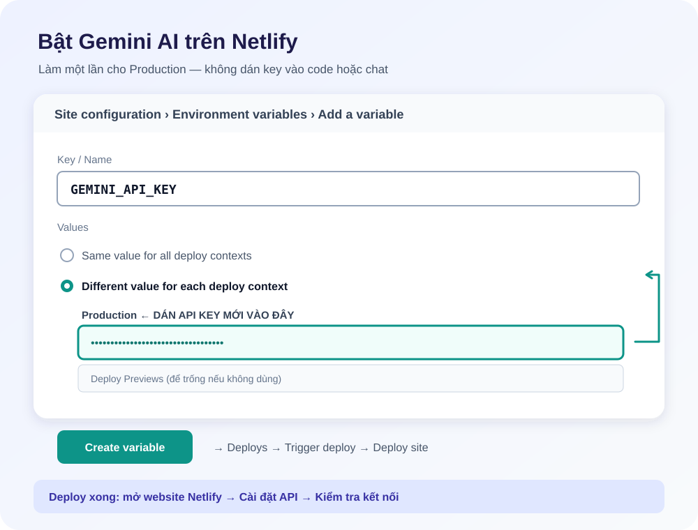

# AI Vocab Master - Từ Điển & Lịch Sử Thông Minh Tích Hợp AI

Ứng dụng web tra từ vựng tiếng Anh chuyên sâu tích hợp **Google Gemini AI**, hỗ trợ phát âm bản xứ, tra cứu từ loại liên quan (Word Family), lưu trữ lịch sử theo dạng cây phân cấp **Năm -> Ngày tra**, và tích hợp chế độ luyện thẻ Flashcards.

---

## 🌟 Tính Năng Nổi Bật

1. **Tra Cứu & Dịch Thuật Chuyên Sâu Bằng Gemini AI**:
   - Tự động nhận diện từ vựng, cấp độ CEFR (A1 - C2), nghĩa tiếng Việt chính xác và định nghĩa tiếng Anh.
   - Các câu ví dụ song ngữ thực tế, làm nổi bật từ đang học.
   - **Mẹo ghi nhớ từ vựng (Memory Tip)** phân tích gốc từ (etymology) hoặc liên tưởng trực quan.
   - Cụm từ thường gặp (Collocations) & Từ đồng nghĩa / Trái nghĩa.

2. **Các Từ Loại Liên Quan (Word Family)**:
   - Tự động phân loại 4 nhóm chính: **Danh từ (Noun)**, **Động từ (Verb)**, **Tính từ (Adjective)**, **Trạng từ (Adverb)**.
   - Mọi từ loại liên quan đều có thể nhấp trực tiếp vào để tra tiếp từ đó.

3. **Phát Âm Chuẩn Bản Xứ (Pronunciation & Audio)**:
   - Phiên âm quốc tế IPA chuẩn Anh - Anh (UK) và Anh - Mỹ (US).
   - Nút nghe phát âm giọng đọc bản ngữ qua Web Speech API.
   - Điều chỉnh tốc độ phát âm (1.0x, 0.75x, 0.5x) phù hợp khi luyện nghe.

4. **Thanh Cột Lịch Sử Bên Trái (Hierarchical Timeline)**:
   - Tự động phân cấp: **Năm tra cứu (Year)** ➔ **Ngày tra cứu (Date)** ➔ **Danh sách từ đã tra trong ngày**.
   - Hiển thị thời gian tra (giờ:phút), từ loại tóm tắt, nghĩa nhanh.
   - Nút phát âm trực tiếp ngay trên thanh lịch sử.
   - Đánh dấu từ yêu thích (Favorite / Bookmark ⭐).
   - Tìm kiếm nhanh từ khóa trong lịch sử.
   - Thu gọn / Mở rộng thanh bên (Sidebar toggle) mượt mà.

5. **Chế Độ Luyện Flashcard**:
   - Lật thẻ 3D trực quan để ôn tập từ vựng đã tra.
   - Ghi nhận trạng thái "Đã nhớ" cùng hiệu ứng chúc mừng (confetti).

6. **Xuất Dữ Liệu & Lưu Trữ An Toàn**:
   - Dữ liệu lưu trữ tự động trên máy tính của bạn (`localStorage`), không lo mất khi tải lại trang.
   - Xuất lịch sử ra file CSV (tương thích Excel, Anki, Quizlet).

7. **Giao Diện Hiện Đại & Tối Ưu**:
   - Thiết kế Glassmorphism tinh tế, chế độ Sáng / Tối (Dark & Light Mode).
   - Phím tắt:
     - `Enter`: Tra từ
     - `Ctrl + K` hoặc `/`: Focus nhanh vào ô tìm kiếm
     - `Space`: Lật thẻ trong chế độ Flashcard
     - `Esc`: Đóng popup

---

## 🚀 Cách Sử Dụng

### Chạy trên máy tính
Gemini được gọi qua máy chủ cục bộ; không mở trực tiếp `index.html`.

1. Tạo API key tại [Google AI Studio](https://aistudio.google.com/).
2. Mở PowerShell và thiết lập key một lần cho tài khoản Windows của bạn:
   ```powershell
   [Environment]::SetEnvironmentVariable("GEMINI_API_KEY", "YOUR_NEW_KEY", "User")
   ```
3. Đóng/mở lại terminal rồi chạy **`start.bat`**. Máy chủ chỉ lắng nghe trên máy tính của bạn (`127.0.0.1`); key không được gửi xuống trình duyệt hay lưu trong repository.
4. Lần tra từ đầu tiên sẽ tự gọi Gemini 3.1 Flash-Lite ở chế độ nền. Có thể dùng **Cài đặt API → Kiểm tra kết nối** để xác nhận máy chủ.

### Triển khai trên Netlify
Code kết nối Netlify Function đã có sẵn. Chỉ cần cấu hình key một lần cho bản Production:



1. Netlify → chọn đúng site → **Site configuration → Environment variables → Add a variable**.
2. **Key/name:** `GEMINI_API_KEY`. Chọn **Different value for each deploy context**, dán key mới vào ô **Production**. Có thể để trống Deploy Previews, Branch deploys và Local development nếu không dùng các môi trường đó. Đừng để key chỉ ở Local development.
3. Bấm **Create variable** để lưu. Vào **Deploys → Trigger deploy → Deploy site** để áp dụng key vào Function.
4. Mở URL website Netlify sau khi deploy xong → **Cài đặt API → Kiểm tra kết nối**. Khi thành công, lần tra từ sẽ tự gọi Gemini 3.1 Flash-Lite. Nút kiểm tra báo thiếu key thì kiểm tra lại ô Production và deploy lại.

Khi GitHub đã kết nối với Netlify, các commit mới lên nhánh Production (thường là `main`) sẽ tự deploy. Function được gắn trực tiếp vào `/api/gemini` và dùng Node.js 20. Nếu dùng tên miền riêng, thêm origin vào `GEMINI_ALLOWED_ORIGINS` (phân tách bằng dấu phẩy). Đặt quota/budget cho API key trong Google AI Studio/Google Cloud.

Nếu key đã từng được gửi trong chat hoặc commit, hãy thu hồi key đó và tạo key mới trước khi cấu hình. Khi Gemini không khả dụng, ứng dụng sẽ thử từ điển dự phòng.
